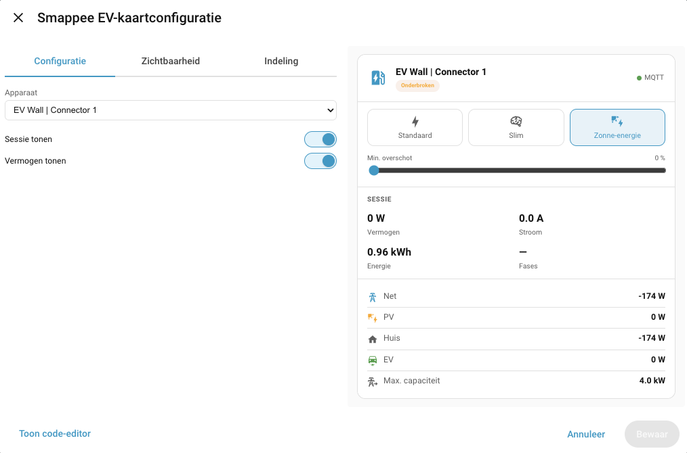

# Smappee EV Card

[](https://github.com/hacs/integration)
[](https://github.com/geertmeersman)
[](https://www.buymeacoffee.com/geertmeersman)

A Lovelace card for [Home Assistant](https://www.home-assistant.io/) that displays status, session info, power overview and controls for a [Smappee EV](https://www.smappee.com/) charging station.



## Requirements

- [Smappee EV integration](https://github.com/geertmeersman/smappee_ev) installed

## Installation via HACS

1. Go to HACS → Frontend
2. Click ⋮ → Custom repositories
3. Add: `https://github.com/geertmeersman/smappee-ev-card`
4. Category: `Lovelace`
5. Install "Smappee EV Card"

[](https://my.home-assistant.io/redirect/hacs_repository/?owner=geertmeersman&repository=smappee-ev-card&category=lovelace)

## Configuration

The card has a visual editor — just pick the device from the dropdown.

```yaml
type: custom:smappee-ev-card
device_id: <device_id>
```

### Options

| Option | Default | Description |
|---|---|---|
| `device_id` | required | Smappee EV charging station device ID |
| `show_session` | `true` | Active session info (power, current, energy, phases) |
| `show_power` | `true` | Grid / PV / house / EV power overview |
